<div align="center">
  <h1>InsightForge</h1>
  <p><b>Real-time log ingestion, search, pattern analysis &amp; alerting, with a macOS-style Liquid Glass dashboard</b></p>

  
  
  
  

  <br/><br/>
  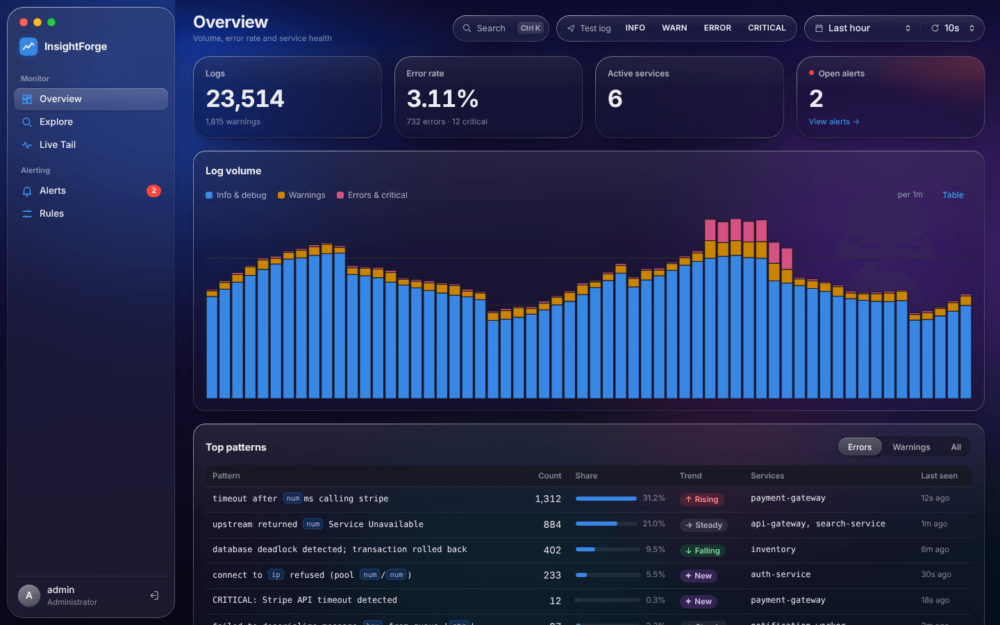
</div>

---

## Contents

- [Overview](#overview)
- [Features](#features)
- [Screenshots](#screenshots)
- [Architecture](#architecture)
- [Getting started](#getting-started)
- [Using the dashboard](#using-the-dashboard)
- [Sending logs](#sending-logs)
- [Reading data (API)](#reading-data-api)
- [Log patterns](#log-patterns)
- [Alerting & notifications](#alerting)
- [Configuration](#configuration)
- [Operations](#operations)
- [Development & testing](#development--testing)
- [Production checklist](#production-checklist)
- [Known limitations](#known-limitations)
- [Roadmap](#roadmap)

---

## Overview

**InsightForge** is a self-hosted observability platform. Your services send logs to it over HTTP. It indexes them in Elasticsearch and gives you a dashboard to search them, watch them live, group them into patterns and get alerted when something goes wrong. Alerts can go to Slack, PagerDuty or any webhook.

The whole stack (Elasticsearch, the FastAPI backend and the React dashboard) starts with one `docker compose` command. A built-in traffic simulator lets you see it working in seconds.

---

## Features

### Ingestion & storage

- **Single and bulk ingestion:** `POST /api/v1/logs` for one log, `POST /api/v1/logs/bulk` for up to 1,000 per request.
- **API-key authentication** for services (`X-API-Key`), and strict schema validation with level aliases (`WARNING` → `WARN`, `FATAL` → `CRITICAL`, …).
- **True batched writes:** logs are buffered in memory and written with the Elasticsearch bulk API, with retries and exponential backoff.
- **Backpressure:** when the buffer is full the API answers `503` with `Retry-After` instead of running out of memory.
- **Rich log fields:** host, environment, `trace_id`/`span_id`, and free-form `attributes` stored in a `flattened` field.
- **Elasticsearch data stream with ILM:** daily rollover and automatic deletion after a configurable number of days (14 by default).

### Search & exploration

- Full-text search with `"exact phrase"`, `-exclude` and `a | b` (OR).
- Filters by level, service (wildcards like `payment-*`), trace id and host, with relative (`now-15m`) or absolute time ranges.
- Stable cursor pagination ("Load more") over large result sets.
- **Log detail view** showing every field and attribute, with **"Show all logs in this trace"** and **Copy JSON**.
- **Export** of matching logs as CSV or NDJSON (up to 10,000). CSV cells are protected against spreadsheet formula injection.

### Pattern analysis

- Collapses thousands of similar messages into templates such as `timeout after <num>ms calling stripe`.
- Masks the parts that vary: numbers, ids, hashes, UUIDs, IPs, URLs, emails and quoted values.
- Shows count, share, services and a **new / rising / steady / falling** trend for each pattern.
- One click opens the logs behind a pattern.
- Appears on the Overview (scoped to Errors / Warnings / All) and as a *Patterns* view in Explore that follows your filters.

### Live tail

- Streams logs over Server-Sent Events, with filters for level, service and message.
- Pause/resume, a logs-per-second readout, automatic reconnection and auto-scroll that stops when you scroll up.

### Alerting

- **Configurable rules:** levels × services (wildcards) × message text × *N matching logs within a time window*.
- Alerts are tracked **per service** by default, or across all services.
- **De-duplication**, **cooldowns**, **acknowledge / resolve** and **auto-resolve** after a quiet period.
- Alerts and rules are stored in Elasticsearch, so they survive restarts. Three sensible default rules are created on first start.

### Notifications

- **Slack** (Block Kit messages), **PagerDuty** (Events v2 trigger and resolve with de-duplication keys) and a **generic webhook** signed with HMAC-SHA256.
- **"Send test"** button for each configured channel.
- **In-app notification banners** in macOS style when new alerts open, plus optional **desktop notifications** when the tab is in the background.

### Dashboard (macOS + Liquid Glass)

- Translucent glass surfaces with light-catching edges and a highlight that follows your pointer, over a slowly drifting wallpaper.
- Floating sidebar with traffic lights, glass toolbar pill buttons, sheet-style dialogs, macOS-style controls (toggles, segmented controls, pop-up menus) and a **lock-screen-style sign-in**.
- **Spotlight-style command palette (⌘K / Ctrl K):** jump to pages, services and alerts, search logs, look up a trace, create a rule or send a test log. Ranked with a "Top Hit" like Spotlight, and fully keyboard-driven.
- Overview with summary tiles, a log-volume chart computed on the server, top patterns, per-service volume and error rate, and open alerts.
- **Accessible:** chart colors were checked for color-blindness and contrast, every chart has a table view, and the UI respects the system's **Reduce transparency** and **Reduce motion** settings. A responsive layout supports narrow screens.

### Security & operations

- JWT login with **admin** and **viewer** roles, and ingestion API keys.
- Elasticsearch security enabled and bound to localhost; non-root containers.
- Rate-limited login, a Content-Security-Policy and security headers (nginx).
- The backend **refuses to start in production with default secrets**.
- Health checks (`/healthz`, `/readyz`), Prometheus `/metrics`, and structured JSON logs with request IDs.
- Graceful shutdown that writes out buffered logs; containers start in dependency order once health checks pass.

### Quality

- 68 backend unit tests plus API tests against an in-memory Elasticsearch fake; ruff and mypy.
- A GitHub Actions pipeline that **boots the full stack and runs an end-to-end smoke test**.

---

## Screenshots

> The screenshots use sample data.

| | |
|---|---|
| **Lock-screen sign-in**<br/>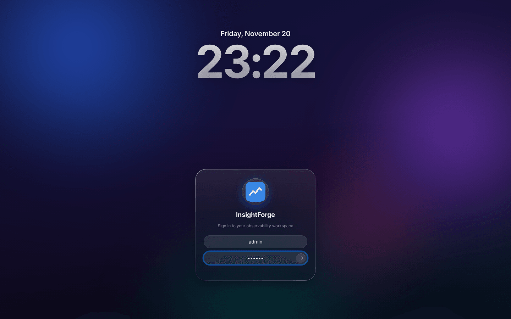 | **Overview: KPIs and log volume**<br/> |
| **Overview: top patterns, services, open alerts**<br/>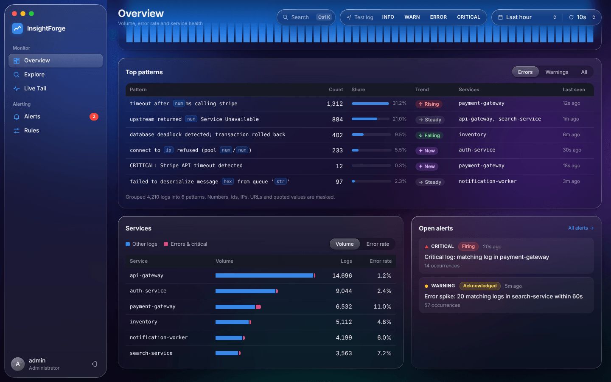 | **Explore: search and filter**<br/>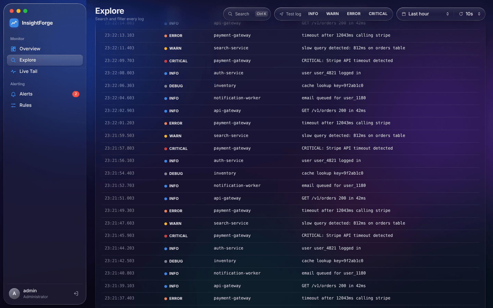 |
| **Log detail sheet**<br/>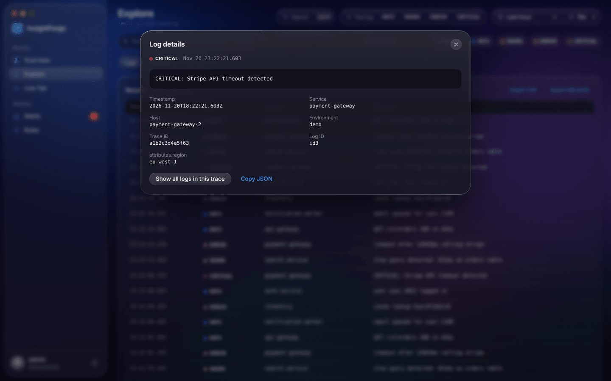 | **Explore: patterns view**<br/>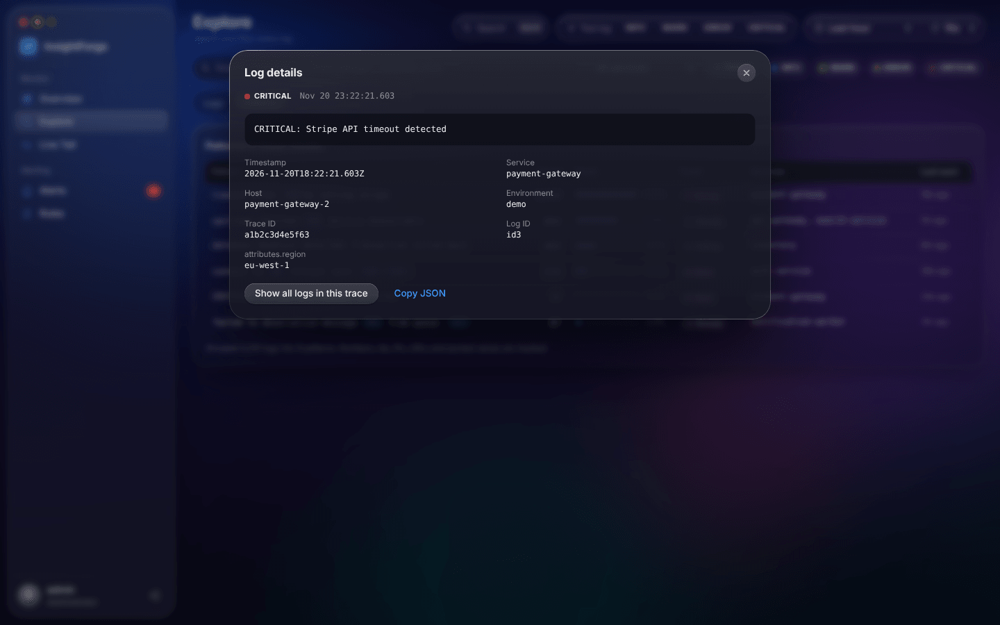 |
| **Live tail**<br/>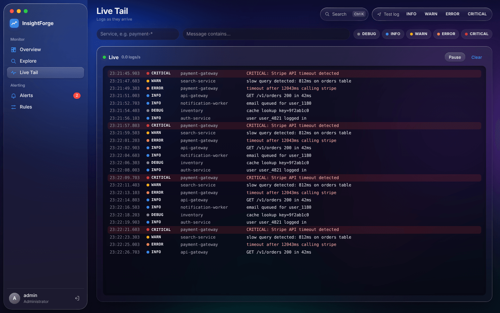 | **Alerts**<br/>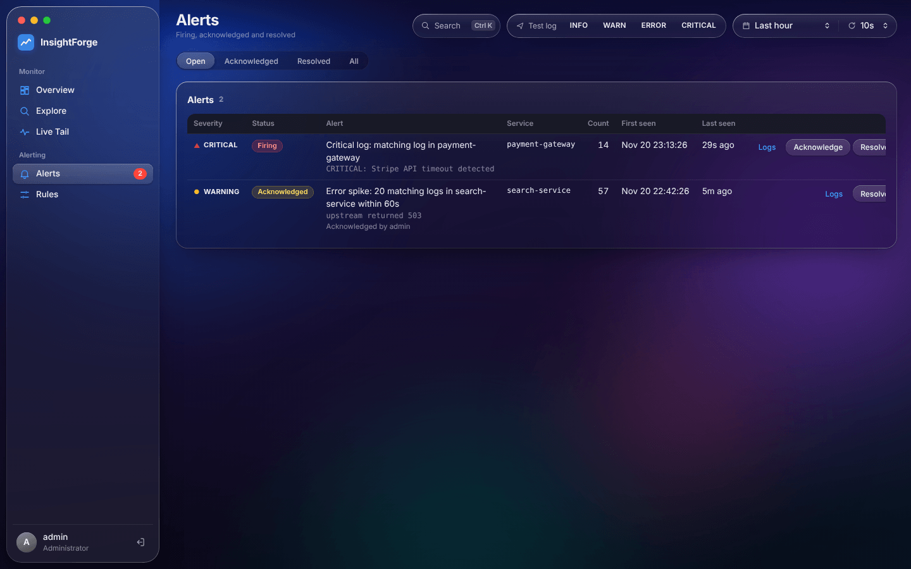 |
| **Alert rules and notification channels**<br/>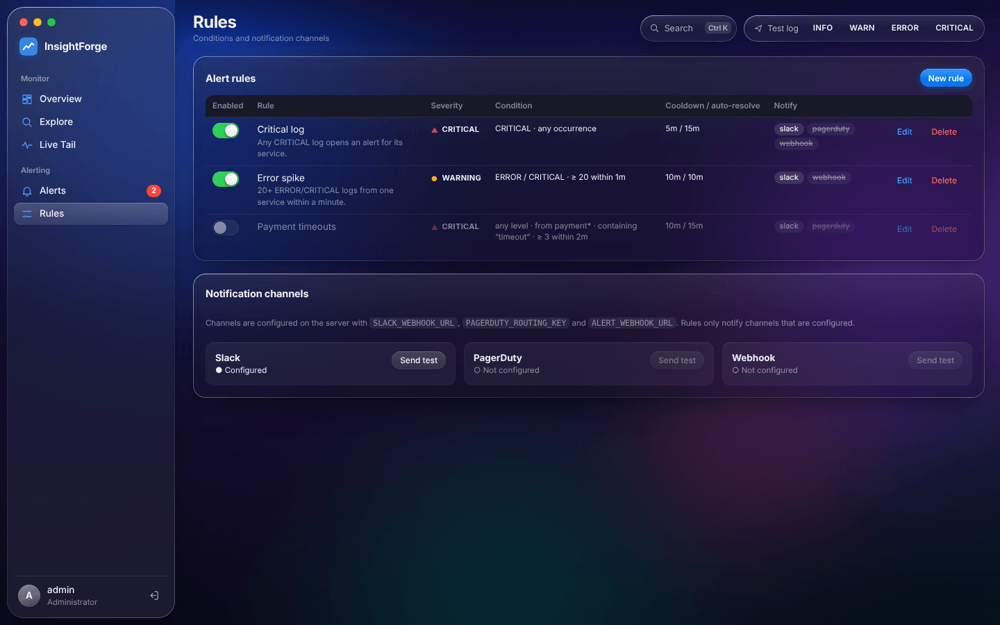 | **Rule editor**<br/>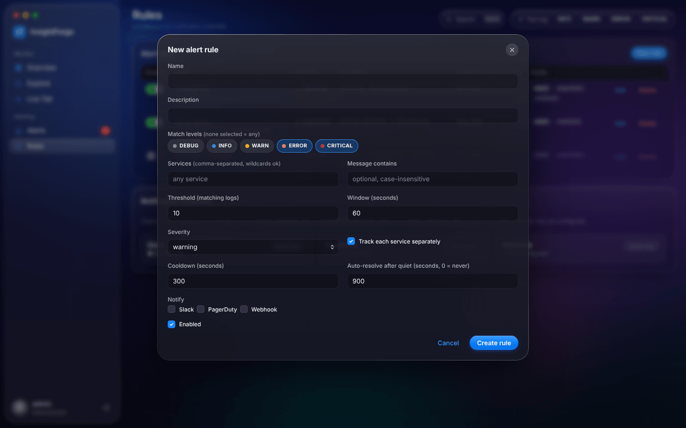 |
| **Command palette (⌘K)**<br/>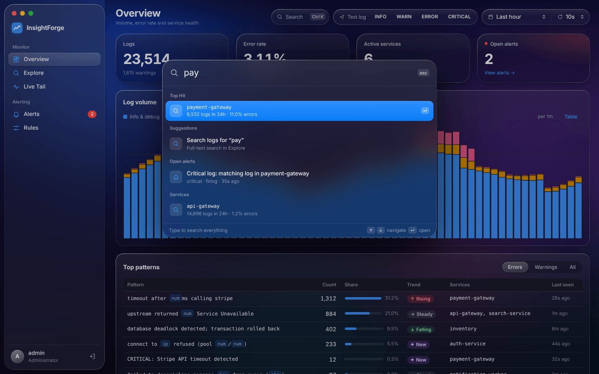 | **New-alert notification banner**<br/>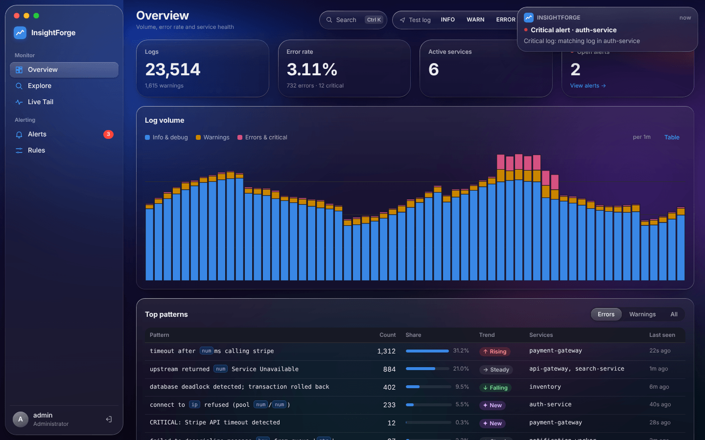 |

---

## Architecture

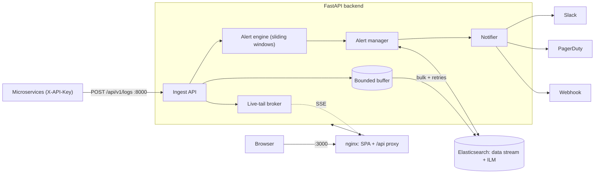

When a log is accepted, the HTTP call returns `202` immediately. In memory, the log is:

1. put into a bounded queue that a background worker writes to Elasticsearch in bulk batches;
2. sent to live-tail subscribers;
3. checked against the alert rules.

Alerts are saved to their own index. Notifications are sent asynchronously, so a slow webhook never slows down ingestion. Patterns are computed when requested, from a sample of the newest matching logs.

### Project structure

```text
insightforge/
├── backend/
│   ├── app/
│   │   ├── main.py                 app factory, lifespan, error handlers
│   │   ├── schemas.py              request/response models
│   │   ├── core/                   config, security, JSON logging, Prometheus metrics
│   │   ├── api/routes/             auth, ingest, logs, stats (+patterns), alerts & rules, stream, health
│   │   └── services/
│   │       ├── ingest_buffer.py    batching, retries, backpressure
│   │       ├── alert_engine.py     sliding-window rule evaluation
│   │       ├── alert_manager.py    alert lifecycle, de-dup, cooldown, auto-resolve
│   │       ├── notifier.py         Slack / PagerDuty / webhook delivery
│   │       ├── patterns.py         log pattern mining
│   │       ├── queries.py          Elasticsearch query builders
│   │       ├── elastic.py          ILM, index template, data stream, bulk sink
│   │       └── stores.py           rule & alert persistence
│   ├── tests/                      unit tests + API tests (in-memory ES fake)
│   ├── scripts/loadgen.py          realistic traffic simulator
│   └── Dockerfile
├── frontend/
│   ├── src/
│   │   ├── components/             pages, PatternList, CommandPalette, NotificationBanners, ui
│   │   ├── hooks/                  auth, data fetching, time range, specular highlight
│   │   └── styles.css              macOS / Liquid Glass design system
│   ├── nginx.conf                  production server + reverse proxy
│   └── Dockerfile
├── docs/screenshots/               images used in this README
├── scripts/smoke_test.sh           end-to-end check against a running stack
├── .github/workflows/ci.yml        lint, types, tests, build, e2e
├── docker-compose.yml
├── Makefile
└── .env.example
```

---

## Getting started

**Prerequisites:** Docker with Compose v2. Give Docker at least 4 GB of RAM, because Elasticsearch uses a 1 GB heap by default.

```bash
git clone https://github.com/zinmeir/insightforge.git
cd insightforge
docker compose --profile demo up --build
```

The `demo` profile adds a traffic simulator that produces realistic logs, including occasional incidents that trigger alerts. Leave `--profile demo` off to start with an empty system.

| | URL | |
|---|---|---|
| Dashboard | <http://localhost:3000> | sign in with `admin` / `admin` (development defaults) |
| API docs (Swagger) | <http://localhost:8000/docs> | |
| Elasticsearch | <http://localhost:9200> | `elastic` / `insightforge-dev`, bound to localhost only |

To change any setting, run `cp .env.example .env` and edit it. `make help` lists the shortcuts (`make demo`, `make smoke`, `make logs`, …).

> **Linux hosts:** Elasticsearch needs `sudo sysctl -w vm.max_map_count=262144`.

---

## Using the dashboard

| Page | What it's for |
|---|---|
| **Overview** | Summary tiles, log volume by level, top patterns, per-service health, open alerts |
| **Explore** | Search, filter, page through and export logs; switch to the *Patterns* view; open a log to see its details or its whole trace |
| **Live Tail** | Stream logs as they arrive, with filters |
| **Alerts** | Open, acknowledged and resolved alerts; acknowledge and resolve; turn on desktop notifications |
| **Rules** | Create, edit, enable/disable and delete alert rules; check notification channels and send test notifications |

### Keyboard shortcuts

| Shortcut | Action |
|---|---|
| <kbd>⌘</kbd> <kbd>K</kbd> / <kbd>Ctrl</kbd> <kbd>K</kbd> | Open / close the command palette |
| <kbd>/</kbd> | Open the command palette (when you're not typing in a field) |
| <kbd>↑</kbd> <kbd>↓</kbd> <kbd>↵</kbd> | Move through and run palette results |
| <kbd>Esc</kbd> | Close the palette or a dialog |
| <kbd>↵</kbd> on a table row | Open that log, pattern or service |

In the palette, type a service name, an alert, a page or an action ("new rule", "test error"). Any text can be searched as logs, and a hex string is offered as a trace lookup.

---

## Sending logs

```bash
# one log
curl -X POST http://localhost:8000/api/v1/logs \
  -H "X-API-Key: dev-ingest-key" -H "Content-Type: application/json" \
  -d '{"level":"ERROR","service":"payment-gateway","message":"CRITICAL: Stripe API timeout detected"}'

# a batch (up to 1000), with optional fields
curl -X POST http://localhost:8000/api/v1/logs/bulk \
  -H "X-API-Key: dev-ingest-key" -H "Content-Type: application/json" \
  -d '[{"level":"WARN","service":"checkout","message":"retrying payment",
        "timestamp":"2026-11-20T10:00:00Z","host":"checkout-2","environment":"prod",
        "trace_id":"4bf92f3577b34da6","attributes":{"attempt":2,"region":"eu-west-1"}}]'
```

| Field | Rules |
|---|---|
| `level` | `DEBUG`, `INFO`, `WARN`, `ERROR`, `CRITICAL`. Case-insensitive; `WARNING`, `FATAL`, `ERR` and `TRACE` are accepted as aliases. |
| `service` | 1–128 characters: letters, digits, `. _ - / :` |
| `message` | 1–32,768 characters |
| `timestamp` | optional ISO-8601; defaults to the time it was received; stored in UTC |
| `host`, `environment`, `trace_id`, `span_id` | optional strings |
| `attributes` | optional flat object (≤64 keys) of string, number, boolean or null values |

Responses: `202` accepted · `401` bad or missing key · `413` batch too large · `422` validation error · `503` buffer full (wait for the `Retry-After` time, then retry).

The original `POST /api/ingest` endpoint still works, but it's deprecated.

---

## Reading data (API)

Every read endpoint needs `Authorization: Bearer <token>` from `POST /api/v1/auth/login`. The full interactive reference is at `/docs`.

| Endpoint | Purpose |
|---|---|
| `GET /api/v1/logs?q=&level=&service=&trace_id=&host=&from=now-1h&to=now&size=&cursor=` | search, newest first; pass `next_cursor` back to get the next page |
| `GET /api/v1/logs/{id}` | one log |
| `GET /api/v1/logs/export?format=csv\|ndjson&limit=` | export (≤10,000 rows) |
| `GET /api/v1/stats/overview` · `/histogram` · `/services` | dashboard aggregations (same filters as search) |
| `GET /api/v1/stats/patterns?size=&sample=` | message patterns over the newest `sample` matching logs (same filters) |
| `GET /api/v1/stream?level=&service=&q=` | live tail (Server-Sent Events, `event: logs`) |
| `GET/POST/PATCH/DELETE /api/v1/rules` | alert rules (changes need the admin role) |
| `GET /api/v1/alerts?status=open\|acknowledged\|resolved\|all` | alerts |
| `POST /api/v1/alerts/{id}/acknowledge` · `/resolve` | alert actions |
| `GET /api/v1/notifications/channels` · `POST /api/v1/notifications/test` | notification channel status and test delivery |
| `GET /api/v1/system/info` | version, retention, buffer depth, configured channels |

Times are ISO-8601 or relative (`now-15m`, `now-6h`, `now-7d`); a range can't exceed 90 days.

---

## Log patterns

Pattern mining turns a wall of near-duplicate messages into a short ranked list:

| Raw messages | Pattern |
|---|---|
| `timeout after 12043ms calling stripe`<br/>`timeout after 98ms calling stripe` | `timeout after <num>ms calling stripe` |
| `connect to 10.0.3.17:5432 refused` | `connect to <ip> refused` |
| `cache lookup key=9f2ab1c0` | `cache lookup key=<hex>` |
| `query 'red shoes' returned 12 hits` | `query '<str>' returned <num> hits` |

- Masked values: `<num>`, `<hex>`, `<uuid>`, `<ip>`, `<url>`, `<email>`, `<str>`. Version-like tokens such as `v1` are kept.
- **Trend** compares the newer half of the sample with the older half: **new** (only in the newer half), **rising** (≥2×), **falling** (≤½) or **steady**.
- Each pattern includes a ready-made `query` (e.g. `"timeout after" "calling stripe"`) that finds its logs in Explore.
- It analyses the newest `sample` matching logs (default 5,000, max 10,000) and says when the full match set was larger.

---

<a id="alerting"></a>

## Alerting & notifications

A rule matches a log when **all** of its conditions hold:

- **levels:** one of the listed levels (empty = any level)
- **services:** an exact name or a wildcard such as `payment-*` (empty = any service)
- **message_contains:** a case-insensitive substring
- **threshold / window_seconds:** at least *threshold* matching logs within the window

With `group_by_service` on (the default), each service is tracked and alerted on separately. Lifecycle:

```text
firing ──acknowledge──▶ acknowledged ──resolve / auto-resolve──▶ resolved
```

- **De-duplication:** while an alert is open, new matches increase its count instead of opening another alert.
- **Cooldown:** after an alert opens, the same rule + service can't open a new one until `cooldown_seconds` have passed.
- **Auto-resolve:** an alert resolves after `auto_resolve_seconds` with no matching logs (`0` turns this off).

Default rules created on first start: **Critical log**, **Error spike** (20+ errors per minute per service) and **Payment timeouts** (an example of message and wildcard matching).

### Notification channels

Set any of these in `.env`; a rule only notifies channels that are configured.

| Channel | Setting | Behaviour |
|---|---|---|
| Slack | `SLACK_WEBHOOK_URL` | Block Kit message when an alert opens and when it resolves |
| PagerDuty | `PAGERDUTY_ROUTING_KEY` | Events v2 `trigger`/`resolve`, using the alert fingerprint as `dedup_key` |
| Webhook | `ALERT_WEBHOOK_URL` (+ `ALERT_WEBHOOK_SECRET`) | JSON `{"event":"alert.opened"\|"alert.resolved","alert":{…}}` |
| In-app | always on | macOS-style banner when a new alert opens; desktop notification if enabled |

Delivery is retried up to 3 times with backoff on network errors, `429` and `5xx` responses. To verify webhook signatures:

```python
import hmac, hashlib
expected = "sha256=" + hmac.new(SECRET.encode(), request_body, hashlib.sha256).hexdigest()
assert hmac.compare_digest(expected, request.headers["X-InsightForge-Signature"])
```

---

## Configuration

All settings are environment variables; see [`.env.example`](.env.example).

| Variable | Default | |
|---|---|---|
| `ENVIRONMENT` | `development` | `production` refuses to start with default secrets |
| `ELASTIC_PASSWORD` | `insightforge-dev` | password for the Elasticsearch `elastic` user |
| `LOG_RETENTION_DAYS` | `14` | ILM deletes older indices |
| `JWT_SECRET` | dev value | ≥32 random characters in production |
| `ADMIN_USERNAME` / `ADMIN_PASSWORD` | `admin` / `admin` | full access |
| `VIEWER_USERNAME` / `VIEWER_PASSWORD` | unset | read-only account (can still acknowledge alerts) |
| `INGEST_API_KEYS` | `dev-ingest-key` | comma-separated |
| `AUTH_ENABLED` | `true` | turn off only for local experiments |
| `INGEST_BATCH_SIZE` / `INGEST_FLUSH_INTERVAL_SECONDS` | `500` / `1.0` | bulk-write tuning |
| `INGEST_QUEUE_MAX_SIZE` | `50000` | backpressure threshold |
| `INDEX_REPLICAS` | `0` | set ≥1 on a multi-node cluster |
| `SLACK_WEBHOOK_URL`, `PAGERDUTY_ROUTING_KEY`, `ALERT_WEBHOOK_URL`, `ALERT_WEBHOOK_SECRET` | unset | notification channels |
| `PUBLIC_DASHBOARD_URL` | `http://localhost:3000` | used for links in notifications |

---

## Operations

- **Health:** `GET /healthz` is a liveness check with no dependencies. `GET /readyz` checks that Elasticsearch is reachable and the buffer is running, and returns `503` otherwise.
- **Metrics:** `GET /metrics` on port 8000 exposes `insightforge_logs_received_total`, `_logs_indexed_total`, `_logs_dropped_total{reason}`, `_ingest_queue_depth`, `_bulk_flush_duration_seconds`, `_alerts_opened_total`, `_notifications_total{channel,outcome}`, `_http_request_duration_seconds{route}` and more.
- **Logs:** one JSON object per line, with a `request_id` that is also returned in the `X-Request-ID` response header.
- **Shutdown:** on `SIGTERM` the API stops accepting logs, writes the buffer to Elasticsearch, saves pending alert counters and closes its connections.

---

## Development & testing

```bash
# backend (Python 3.12)
cd backend && python -m venv .venv && source .venv/bin/activate
pip install -r requirements-dev.txt
pytest && ruff check . && mypy app
docker compose up -d elasticsearch
ELASTICSEARCH_USERNAME=elastic ELASTICSEARCH_PASSWORD=insightforge-dev uvicorn app.main:app --reload

# frontend (Node 20); Vite proxies /api to :8000
cd frontend && npm install && npm run dev

# whole stack, end to end
docker compose up -d --build --wait && ./scripts/smoke_test.sh
```

The CI pipeline (`.github/workflows/ci.yml`) runs lint, type checks and tests, builds the frontend, then starts the full Docker stack and runs `scripts/smoke_test.sh`. The smoke test logs in through nginx, ingests logs, searches them, checks aggregations, opens and resolves an alert, exports CSV, and checks the live stream and metrics.

Commit `frontend/package-lock.json` after your first `npm install`; the Docker build switches to `npm ci` automatically when it exists.

---

## Production checklist

- [ ] `ENVIRONMENT=production`, plus strong `JWT_SECRET`, `ADMIN_PASSWORD`, `ELASTIC_PASSWORD` and `INGEST_API_KEYS`
- [ ] Put TLS in front of ports 3000 and 8000 (a load balancer or reverse proxy), and set `PUBLIC_DASHBOARD_URL`
- [ ] Give the backend a dedicated Elasticsearch role or API key (`ELASTICSEARCH_API_KEY`) instead of the `elastic` superuser
- [ ] Use a multi-node cluster with `INDEX_REPLICAS=1`, with heap and disk sized for your retention
- [ ] Keep `/metrics` and port 9200 on a private network; scrape metrics with Prometheus
- [ ] Back up the `insightforge-alert-rules` index (or snapshot the cluster)

## Known limitations

- **One backend replica.** Alert windows, de-duplication state and the live-tail broker live in process memory. Moving them to Redis (or similar) is the next step for horizontal scaling.
- **Accounts come from environment variables.** Fine for small teams; OIDC/SSO is the upgrade path.
- **Logs buffered in memory can be lost if the process crashes.** They're flushed on a clean shutdown. For guaranteed delivery, put a queue such as Kafka in front of ingestion.
- **Dark mode only.** A light theme would need the chart palette re-validated on light glass.

## Roadmap

- Redis-backed alert state and pub/sub for multi-replica deployments
- OIDC single sign-on and per-team API keys with scopes
- Saved searches and shareable dashboard links
- Pattern-based alert rules (alert when a *new* pattern appears)
- OpenTelemetry (OTLP) log ingestion endpoint
- Light mode

---

<div align="center">
  <i>Built by <a href="https://github.com/zinmeir">Muhammad Shaheer Akhtar</a></i>
</div>
